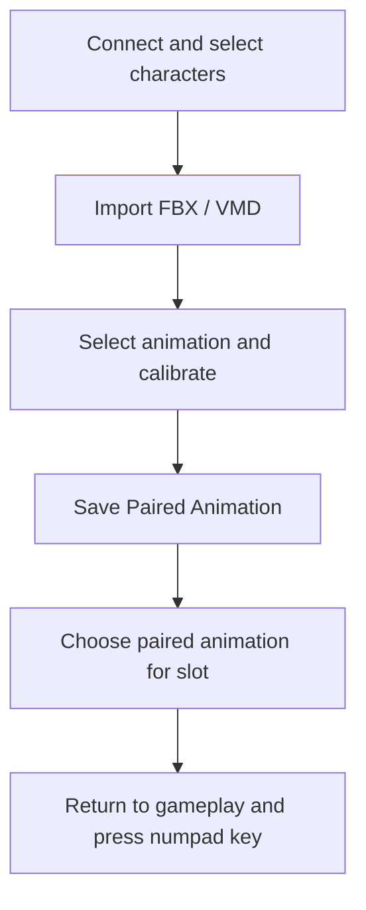

# EndfieldAnimationImporter User Guide

> **Loader:** Version 1.4.0 and earlier use [BEM 3.4.3](https://github.com/Dr-hydra/Better-Endfield); version 1.5.0 onward uses [EML](https://github.com/Dr-hydra/Endfield-Mod-Loader).

[繁體中文](README.md) | English

Version: 2.3.3 · Windows x64

## Before You Start

- Install EML. Importing FBX/VMD also requires [Blender](https://www.blender.org/download/) 4.2 or later.
- Control the male or female Endministrator. Partners can be selected from the whitelist and are spawned automatically when outside the squad.
- Disable other first-person/camera modules before starting the game.

1. Import the EAI ZIP in EML, enable it, and use **Launch Game**. Restart the game after updating the module.
2. Enter a playable scene and press **Num0** to open the panel.
3. Under **Module Settings → Partner**, select **Connect Game Entry**.
4. Choose a partner from the whitelist dropdown. A model is spawned automatically if the operator is not in your squad.

## Quick Start

## Import Animations

1. Stop the current animation and check your Endministrator and partner.
2. Open **Animation Import** and check the Blender path. If it is missing, choose the folder containing `blender.exe`.
3. Use **Import Controlled FBX / VMD** or **Import Partner FBX / VMD**, select a file, and wait for completion.
4. Select the animation in the corresponding calibration menu. Importing does not automatically start playback.

VMD needs no MMD reference model; only motion is imported. **Not all FBX skeletons are supported. Only single-character animations are supported.** Import each character's motion separately for a two-person animation.

Controlled animations are bound to the male or female Endministrator used during import. If a partner animation looks incorrect on another character, select that character and reimport.

Without an imported controlled animation, choose a default Endministrator pose: standing, waist hug, or head pat. Select **None** to disable it. These poses are experimental and may need placement adjustments.

## Calibrate Animations

The controlled character and partner have separate calibration menus. Selecting an animation displays its timeline in a paused state.

| Control | Purpose |
| --- | --- |
| Play / Stop Animation | Preview / restore the character, keeping adjustments |
| Loop Calibration Animation | Repeat playback |
| Time slider, Previous / Next Frame | Seek and pause; each frame is 1/30 second |
| Resume / Pause Timeline | Resume or pause at the current time |
| Mark Start / End, Loop Range | Select and repeat a clip |
| Sync Controlled / Partner Animations | Synchronize playback, stop, pause, time, and range markers |

Playing or stopping does not close the panel. Press **Num0 or Esc** to return to gameplay.

### Bones and Placement

1. Under **Bone Settings**, refresh all bones.
2. Expand the controlled character or partner and adjust the desired bone. The character root moves or rotates the entire character; positions use centimetres and angles use degrees.
3. Drag a slider or click its value to enter a number. Negative values and decimals are accepted.
4. Use **Restore Default Bones** to clear adjustments.

Pause at the same frame before adjusting to make comparison easier.

### Support Modes

- **Free:** General motion, jumping, or lifting feet.
- **Left / Right Foot:** Use one foot as the support point.
- **Left / Right Knee:** Use one knee as the support point.

Support does not automatically detect the ground. Adjust the character root's Y position if a foot or knee is at the wrong height. Stop and replay to reset the support point.

## Paired Animations and Hotkeys

1. Calibrate both characters, then press **Save Paired Animation**.
2. Expand **Interaction Presets** and choose a Numpad 1–9 slot.
3. Assign an entry from the **Paired Animations** dropdown. Save Settings after changing a slot name or enabled state.
4. Turn on **Num Lock**, return to gameplay, and press the assigned numpad key.

**Press the same key to stop or another configured key to switch.** Existing presets are migrated automatically with their hotkey assignments preserved.

Default names use the first five characters of the main animation, `x`, the first five of the partner animation, `x`, and the partner name. Use **Rename** on the right to change the name without affecting animations, parameters, or hotkeys.

Expand **Paired Animations** above partner calibration to load both animations and their parameters. The selected partner is retained. Supported partners load their dedicated parameters for both characters; unsupported partners use the original parameters and can be calibrated and added as supported partners.

To support another operator, keep the same two animations, change the partner, calibrate both characters, then press **Add Support for Current Partner**. The save-pair button is disabled for an existing pair. To revise a supported partner, recalibrate and click **Update Current Partner Parameters**. This saves both characters’ parameters for that partner. Other partners remain unchanged; assigned hotkeys use the updated parameters on their next playback.

Each supported operator stores its own parameters for both characters:

| Selected partner | Playback behavior |
| --- | --- |
| Has dedicated parameters | Uses those parameters regardless of the reuse switch |
| Unsupported, reuse disabled | Uses the original saved partner and parameters |
| Unsupported, reuse enabled | Uses the selected partner with the original parameters; proportions may cause offsets |

## Save Clips and Share

Mark a start and end on the timeline. Clips must be at least 0.2 seconds long.

| Button | Purpose |
| --- | --- |
| Save Animation | Add the clip to the local animation list |
| Save Clip As | Save animation JSON without adding it to the list |

Load animation JSON through **Animation Import → Import Partner JSON**. Recipients can import a shared JSON, calibrate it, and save their own animation pair.

## Free Camera

Connect the game entry, check the toggle shortcut under **Free Camera**, close the panel, and press the shortcut to enable it. Press it again or press **Esc** to exit. The default is **F9** and can be changed. While Free Camera is active, press **1–9 (number row or numpad)** to play interaction presets; press the same key to stop or another key to switch.

| Control | Purpose |
| --- | --- |
| WASD | Move forward, backward, left, and right |
| E / Q | Move up / down |
| Hold right mouse button and drag | Turn the camera |
| Hold Shift | Double movement speed |
| Reset Camera Position | Return near the controlled character |

Enable **Hide Game UI When Camera Starts** to hide the game interface and restore it on exit.

## Breast Physics

Enable **Enable Partner Breast Physics** on the **Breast Physics** page.

- **Automatically Apply to Partner** follows the selected partner.
- **Automatically Apply to Controlled Character** follows the controlled character; only one automatic mode can be enabled.
- Manual selection disables both automatic modes and targets a non-controlled partner, including supported generated models.
- Built-in presets are used without parameter controls. Only one character is affected; missing presets or bones are reported on the page.
- Do not apply another breast physics module to the same character simultaneously.

## EFMI External Model Adjustments

Install EFMI and the appearance mod separately.

Choose EFMI's `Mods` folder or one mod folder → scan → adjust parameters/mesh → write the bridge → reload EFMI in-game. The reload key is usually F10; follow the panel's indication.

Reload after restoring defaults or disabling the bridge too. Mesh changes are not applied live.

## Spawn Character

In the rightmost **Spawn Character** tab, the whitelist groups female and male operators. All are enabled by default. Uncheck unwanted operators and press **Save Whitelist**; only checked operators appear in the spawn and partner selectors.

Connect the game entry and enter a playable scene. Select an operator below and press **Spawn** on the right. The model appears about 2 m ahead and becomes the selected interaction partner. Use **Remove Character** below to clear it. Selecting another operator and spawning replaces the existing model.

Import or calibrate a partner animation, or play a hotkey preset. Dedicated operator parameters take priority; enable **Cross-Character Animation Reuse** for an unsupported operator. Generated models take precedence over same-name squad members. Removing a model stops its animation first. Changing the controlled character or losing the model triggers cleanup.

The menu lists currently known operators. Loading depends on resources available in your client; check the status and diagnostic log if it fails. Different skeletons or proportions may require reimporting or calibration. Spawning is local and does not unlock operators.

## Common Problems and Causes

| Problem | Cause and solution |
| --- | --- |
| Panel is missing | Enable EAI in EML and launch the game through EML; restart after updating |
| Cannot connect | The game is not ready, another camera module occupies the entry, or versions are incompatible; retry in a playable scene, disable other camera modules, and restart |
| Blender is not found | Choose the folder containing `blender.exe` manually |
| Import asks you to stop | An animation or calibration preview is active; stop it first |
| FBX import fails | The skeleton may be unsupported or contain multiple characters; use single-character motion |
| VMD import fails | It may contain only camera motion or unsupported bone names; use character motion |
| Distorted motion or character warning | The animation uses a different skeleton/proportions; select the desired character and reimport |
| Controlled character mismatch | The animation is bound to the other Endministrator; switch or reimport |
| Feet sink or hands miss contact | Support, placement, or proportions differ; pause and adjust support and the character root |
| Numpad key does nothing | Num Lock is off, the slot is empty, or the character does not match; check the slot and character prompt |
| Saved clip is missing from the list | Save Clip As does not add it; import that JSON or use Save Animation |
| Paired animation has a missing source | Import the referenced animation JSON first |
| EFMI changes do not appear | The bridge has not been written/reloaded, or the mesh is unsupported |

If the problem persists, provide EAI/EML versions, characters, animation filename, steps, and screenshots. Check EML logs or `Interaction.Diagnostics.log` beside the DLL.

To back up settings and animations, copy the entire `%LOCALAPPDATA%\BetterEndfield\Interaction` folder.

## Credits

Breast bone and character calibration data are based on [Sp1cHless’s Secondary-bodyphysics](https://github.com/Sp1cHless/Arknights-Endfield-Plugin-Secondary-bodyphysics).
