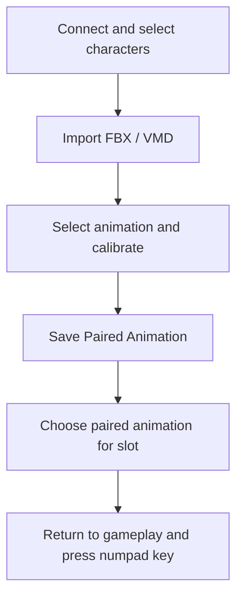

# EndfieldAnimationImporter User Guide

> **Standalone launch** EAI includes its own game host and EFMI loader. Start the game with `EAI.Launcher.exe` from the extracted package.

[繁體中文](README.md) | English

Version: 3.6.7 · Windows x64

## Before You Start

- Extract the EAI package. The native importer handles FBX and VMD directly. The Blender option requires [Blender](https://www.blender.org/download/) 4.2 or later.
- Control the male or female Endministrator. Partners can be selected from the whitelist and are spawned automatically when outside the squad.
- Disable other first-person/camera modules before starting the game.
- EAI suppresses near-camera character fading by default.

1. Extract the full EAI ZIP, open EAI.Launcher.exe, select the game, and launch it. Restart the game after updating.
2. Enter a playable scene and press **Num0** to open the panel.
3. Under **Module Settings → Partner**, select **Connect Game Entry**.
4. Choose a partner from the whitelist dropdown. A model is spawned automatically if the operator is not in your squad.

### EAI Standalone Launcher

- **Browse** to select `Endfield.exe` in your game folder, then click **Launch Game**. The launcher remembers the path.
- **Language** Switch between Traditional Chinese and English in the sidebar. The launcher, in-game panel and web panel use this saved preference.
- **Appearance Mod Guide** The guide opens once, the first time you start the launcher with this feature. Click the X in the title bar to close it, or reopen it from the sidebar.
- **Launch troubleshooting** Check the launch and host logs below the controls, or click **Open Logs**. Windows may ask for approval when the game requires administrator privileges.

If you installed EML DLL autostart, uninstall it from EML before launching through EAI. EAI stores settings and animations in `%LOCALAPPDATA%/BetterEndfield/Interaction`.


## Quick Start



## Import Animations

1. Stop the current animation and check your Endministrator and partner.
2. Under **Animation Import**, set **Import Engine** to EAI or Blender. Your selection is saved and defaults to Blender. With Blender selected, choose the folder containing `blender.exe` if detection fails.
3. Use **Import Controlled FBX / VMD** or **Import Partner FBX / VMD**, select a file, and wait for completion.
4. Select the animation in the corresponding calibration menu. Importing does not automatically start playback.

VMD imports motion without requiring an MMD reference model. Native EAI handles common humanoid FBX skeletons. Import each actor separately for paired animations. VMD leg IK may differ between engines. Select Blender to reproduce its original leg motion.

Controlled animations are bound to the male or female Endministrator used during import. If a partner animation looks incorrect on another character, select that character and reimport.

Without an imported controlled animation, choose a default Endministrator pose: standing, waist hug, or head pat. Select **None** to disable it. These poses are experimental and may need placement adjustments.

## Calibrate Animations

The controlled character and partner have separate calibration menus. Selecting an animation displays its timeline in a paused state.

| Control | Purpose |
| --- | --- |
| Play / Stop Animation | Preview / restore the character, keeping adjustments |
| Loop Calibration Animation | Repeat playback |
| Time slider, Previous / Next Frame | Seek and pause; each frame is 1/30 second |
| Resume / Pause Timeline | Resume or pause at the current time |
| Mark Start / End, Loop Range | Select and repeat a clip |
| Sync Controlled / Partner Animations | Synchronize playback, stop, pause, time, and range markers |

Playing or stopping does not close the panel. Press **Num0 or Esc** to return to gameplay.

### Bones and Placement

1. Under **Bone Settings**, refresh all bones.
2. Expand the controlled character or partner and adjust the desired bone. The character root moves or rotates the entire character; positions use centimetres and angles use degrees.
3. Drag a slider or click its value to enter a number. Negative values and decimals are accepted.
4. Use **Restore Default Bones** to clear adjustments.

Pause at the same frame before adjusting to make comparison easier.

### Support Modes

- **Free:** General motion, jumping, or lifting feet.
- **Left / Right Foot:** Use one foot as the support point.
- **Left / Right Knee:** Use one knee as the support point.

Support does not automatically detect the ground. Adjust the character root's Y position if a foot or knee is at the wrong height. Stop and replay to reset the support point.

## Paired Animations and Hotkeys

1. Calibrate both characters, then press **Save Paired Animation**.
2. Expand **Interaction Presets** and choose a Numpad 1–9 slot.
3. Assign an entry from the **Paired Animations** dropdown. Save Settings after changing a slot name or enabled state.
4. Turn on **Num Lock**, return to gameplay, and press the assigned numpad key.

**Press the same key to stop or another configured key to switch.** Existing presets are migrated automatically with their hotkey assignments preserved.

Default names use the first five characters of the main animation, `x`, the first five of the partner animation, `x`, and the partner name. Use **Rename** on the right to change the name without affecting animations, parameters, or hotkeys.

Expand **Paired Animations** above partner calibration to load both animations and their parameters. The selected partner is retained. Supported partners load their dedicated parameters for both characters; unsupported partners use the original parameters and can be calibrated and added as supported partners.

To support another operator, keep the same two animations, change the partner, calibrate both characters, then press **Add Support for Current Partner**. The save-pair button is disabled for an existing pair. To revise a supported partner, recalibrate and click **Update Current Partner Parameters**. This saves both characters’ parameters for that partner. Other partners remain unchanged; assigned hotkeys use the updated parameters on their next playback.

Each supported operator stores its own parameters for both characters:

| Selected partner | Playback behavior |
| --- | --- |
| Has dedicated parameters | Uses those parameters regardless of the reuse switch |
| Unsupported, reuse disabled | Uses the original saved partner and parameters |
| Unsupported, reuse enabled | Uses the selected partner with the original parameters; proportions may cause offsets |

## Save Clips and Share

Mark a start and end on the timeline. Clips must be at least 0.2 seconds long.

| Button | Purpose |
| --- | --- |
| Save Animation | Add the clip to the local animation list |
| Save Clip As | Save animation JSON without adding it to the list |

Load animation JSON through **Animation Import → Import Partner JSON**. Recipients can import a shared JSON, calibrate it, and save their own animation pair.

## Free Camera

Connect to the game, then select **Enable Free Camera** in the in-game Free Camera tab. The panel will collapse and return focus to the game. You can also close the panel and use the shortcut. Press the shortcut again or press **Esc** to exit. The default shortcut is **F9** and can be changed. While Free Camera is active, press **1–9 (number row or numpad)** to play interaction presets; press the same key to stop or another key to switch.

| Control | Purpose |
| --- | --- |
| WASD | Move forward, backward, left, and right |
| E / Q | Move up / down |
| Hold right mouse button and drag | Turn the camera |
| Hold Shift | Double movement speed |
| Reset Camera Position | Return near the controlled character |

Enable **Hide Game UI When Camera Starts** to hide the game interface and restore it on exit.

## Breast Physics

Enable **Enable Partner Breast Physics** on the **Breast Physics** page.

- **Automatically Apply to Partner** follows the selected partner.
- **Automatically Apply to Controlled Character** follows the controlled character; only one automatic mode can be enabled.
- Manual selection disables both automatic modes and targets a non-controlled partner, including supported generated models.
- Built-in presets are used without parameter controls. Only one character is affected; missing presets or bones are reported on the page.
- Do not apply another breast physics module to the same character simultaneously.

## EFMI External Model Adjustments

1. Launch with EAI and open **External Model Adjustments** in the Num0 or web panel. EAI scans the `mod` folder next to the launcher. Click **Rescan** after adding or removing appearances.
2. Under **External Model Adjustments → Mesh Transform**, drag a supported part's scale, rotation, position, or pivot slider. You can switch parts at any time. Bundled EFMI applies changes live and saves them automatically.
3. To restore a part, use its mesh reset button. To disable all mesh adjustments in the scanned folder, click **Disable Bridge**.

Drag sliders under **Available Parameters** to preview native INI variables loaded by bundled EFMI. Use **Save Settings** to save an override in the bridge. Reload EFMI with F10 when a parameter cannot be previewed or after disabling a loaded legacy bridge.

### Mouth Contact (Experimental)

Enable **Mouth Contact** under **External Model Adjustments** in the Num0 or web panel. It starts off each session. Use the male Endministrator with an EFMI appearance containing `Component 9 / dih` or `Component 9 / weap`, connect to the game, and play a paired animation.

When the DIH approaches the mouth from the front, the entire part rotates around its base and the tip aims at the entrance along a fixed-length arc. Once the DIH mesh touches the lip contact box, its thickness perpendicular to the shaft and the existing opening determine the extra jaw rotation or opening blend shape. Aiming uses the insertion depth of the current pose. The feature uses the poses produced by MMD playback.

The same panel also offers Pelvic Contact, Left-Hand Contact, and Right-Hand Contact. Select one contact target at a time. All contact options start disabled. The new targets use the partner’s bones to estimate the contact point. Pelvic Contact aims the DIH axis at the pelvic anchor within 1.3 times the mesh length from the pivot. The mesh keeps its original length. Hand Contact turns the tip toward the palm. The rotation eases back when the target moves out of reach.

During paired animation playback, the mouth contact sound loops while the meshes touch and stops on separation. Pelvic Contact plays a short sound as the default anchor enters the DIH root contact region and rearms after separation. The sliders move the attachment point independently. Both sounds are included with EAI.

The appearance catalog and mesh probe results are cached in the local EAI data directory. Opening the page for the first time builds the cache. Later scans reuse unchanged appearances and refresh changed files.

Each contact mode has separate X, Y and Z offsets. X ranges from −5 to +5 cm, and Y and Z range from −10 to +10 cm. X moves sideways, Y moves up or toward the fingertips, and Z moves along the opening or palm normal. The offsets follow the partner’s bones, update live and save on release. Moving a slider shows a green point in the game view. It disappears five seconds after the last adjustment. Pelvic Contact also has a 0–100% impact volume slider.

## Complete EFMI Appearance Mods

Click **Open mod Folder** in the launcher sidebar. Extract each EFMI appearance into its own subfolder and keep its INI, meshes, textures, shaders and other dependencies in their original structure.

```text
EAI.Launcher.exe
mod/
  MyAppearance/
    mod.ini
    Meshes/
    Textures/
runtime/
```

When enabled INI files are present, Launch Game also starts the bundled EFMI 1.4.8 / XXMI 1.2.2 loader. EFMI processes the complete appearance through its native INI and rendering pipeline. Show the matching character in the game. Include required shaders or plugins under `mod`, following the appearance author's character, version, and dependency requirements.

The launcher displays the number of discoverable INI files. To disable an appearance, close the game and rename its directory to `DISABLED_originalName`. In-game reload follows EFMI's F10 configuration. Multiple appearances for one character can conflict. The released `mod` folder is initially empty.

## Spawn Character

In the rightmost **Spawn Character** tab, the whitelist groups female and male operators. All are enabled by default. Uncheck unwanted operators and press **Save Whitelist**; only checked operators appear in the spawn and partner selectors.

Connect the game entry and enter a playable scene. Select an operator below and press **Spawn** on the right. The model appears about 2 m ahead and becomes the selected interaction partner. Use **Remove Character** below to clear it. Selecting another operator and spawning replaces the existing model.

Import or calibrate a partner animation, or play a hotkey preset. Dedicated operator parameters take priority; enable **Cross-Character Animation Reuse** for an unsupported operator. Generated models take precedence over same-name squad members. Removing a model stops its animation first. Changing the controlled character or losing the model triggers cleanup.

The menu lists currently known operators. Loading depends on resources available in your client; check the status and diagnostic log if it fails. Different skeletons or proportions may require reimporting or calibration. Spawning is local and does not unlock operators.

## Common Problems and Causes

| Problem | Cause and solution |
| --- | --- |
| Panel is missing | Extract the full package and launch with EAI.Launcher.exe. Enter a playable scene and press Num0. Restart the game after updating |
| Cannot connect | The game is not ready, another camera module occupies the entry, or versions are incompatible; retry in a playable scene, disable other camera modules, and restart |
| Blender is not found | Choose the folder containing `blender.exe` manually |
| Import asks you to stop | An animation or calibration preview is active; stop it first |
| FBX import fails | The skeleton may be unsupported or contain multiple characters; use single-character motion |
| VMD import fails | It may contain only camera motion or unsupported bone names; use character motion |
| Distorted motion or character warning | The animation uses a different skeleton/proportions; select the desired character and reimport |
| Controlled character mismatch | The animation is bound to the other Endministrator; switch or reimport |
| Feet sink or hands miss contact | Support, placement, or proportions differ; pause and adjust support and the character root |
| Numpad key does nothing | Num Lock is off, the slot is empty, or the character does not match; check the slot and character prompt |
| Saved clip is missing from the list | Save Clip As does not add it; import that JSON or use Save Animation |
| Paired animation has a missing source | Import the referenced animation JSON first |
| EFMI changes do not appear | The bridge has not been written/reloaded, or the mesh is unsupported |

If the problem persists, provide the EAI version, characters, animation filename, steps, and screenshots. Use Open Log Folder in the launcher's sidebar to find `launch.log` and `host.log`. Native diagnostics are at `native/windows-x64/Interaction.Diagnostics.log`.

To back up settings and animations, copy the entire `%LOCALAPPDATA%\BetterEndfield\Interaction` folder.

## EAI Offline Host

After extracting the ZIP, run the following command in PowerShell to check the EAI host, profile, and command replies. The offline host loads EAI from the same folder and keeps its profile under `EAI-Offline` inside the directory you specify. In-game features use the game host.

```powershell
@('{"request_id":"workflow","body":{"command":"workflow_get"}}', 'stop') |
  .\native\windows-x64\EAI.OfflineHost.exe --profile .\host-test
```

Send one EAI JSON command per line. The host writes JSON replies to standard output and diagnostics to standard error.

## Credits

Breast bone and character calibration data are based on [Sp1cHless’s Secondary-bodyphysics](https://github.com/Sp1cHless/Arknights-Endfield-Plugin-Secondary-bodyphysics).
