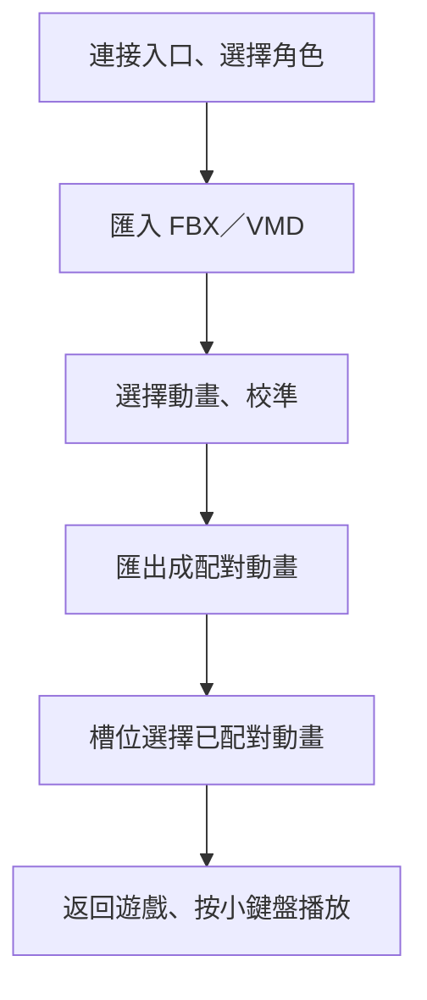

# EndfieldAnimationImporter 使用手冊

> **獨立啟動**　EAI 內建遊戲宿主與 EFMI 外型載入器，直接使用套件內的 `EAI.Launcher.exe` 啟動遊戲。

繁體中文 | [English](README.en.md)

適用版本：3.6.9｜Windows x64

## 使用前準備

- 解壓 EAI 套件。原生匯入可直接處理 FBX／VMD。選用 Blender 處理時，需安裝 [Blender](https://www.blender.org/download/) 4.2 以上。
- 主控使用男性或女性管理員；互動角色可從生成角色白名單中選擇，不在隊伍時會自動生成。
- 停用其他第一人稱／相機模組，再啟動遊戲。
- EAI 啟動遊戲後會預設解除相機靠近角色時的淡出。

1. 完整解壓 EAI ZIP，開啟 EAI.Launcher.exe 選擇遊戲後啟動。更新後需重啟遊戲。
2. 進入可操作角色的場景，按 **Num0** 開啟面板。
3. 在「模組設定 → 互動角色」按「連接遊戲入口」。
4. 在互動角色下拉選單選擇幹員；不在隊伍中的角色會自動生成。

### EAI 獨立啟動器

- **選擇遊戲** 開啟遊戲資料夾中的 `Endfield.exe`，再按「啟動遊戲」。啟動器會記住遊戲路徑。
- **語言** 從左側選擇「繁體中文」或「English」。這個選項會保存，遊戲內和網頁面板讀取同一份設定。
- **外型安裝指南** 第一次開啟新版啟動器時會顯示。按右上角的 X 即可關閉，也能從左側重新開啟。
- **啟動排錯** 若載入失敗，查看下方「啟動與宿主日誌」或按「開啟日誌目錄」。Windows 可能會在需要管理員權限時要求確認。

若遊戲曾裝有 EML 的 DLL 自啟動，先在 EML 卸載該自啟動。EAI 的設定與動畫位於 `%LOCALAPPDATA%/BetterEndfield/Interaction`。


## 使用懶人包



## 匯入動畫

1. 停止目前動畫，確認主控與互動角色。
2. 在「動畫匯入」的「匯入處理器」選擇 EAI 或 Blender。選項會保存，預設為 Blender。選 Blender 時，若未偵測到路徑，請選擇含 `blender.exe` 的資料夾。
3. 按「導入主控 FBX / VMD」或「導入配角 FBX / VMD」，選擇檔案並等待完成。
4. 到「校準模式」的主控／配角選單選擇動畫。匯入完成不會自動播放。

VMD 直接選檔即可，只匯入動作，無需 MMD 參考模型。EAI 原生處理常見人形 FBX 骨架，雙人動作請將兩人分別匯入主控與配角。VMD 的腳部 IK 與 Blender 可能有差異。需要原本的腳部動作時，可切換至 Blender。

主控動畫綁定匯入時的男管／女管。配角更換角色後若動作異常，選好新角色再重新匯入。

未匯入主控動畫時，可用「主控預設姿勢」選擇站立、摟腰或摸頭；不需要則選「無」。這些姿勢為測試功能，接觸位置可能需要調整。

## 校準動畫

主控與配角各有一個校準選單。選擇動畫後會展開時間軸，從暫停狀態開始。

配對預設名稱為「主控動畫前 5 字x互動動畫前 5 字x互動幹員名稱」。按列表右側「重新命名」可自訂，不影響動畫、參數或快捷鍵。

展開上方「已配對動畫」可載入已保存的雙方動畫與參數。保留目前選定的互動角色：已受支援時載入其專屬雙方參數，未受支援時套用配對的原始雙方參數，校準後可新增支援。

首次校準完成後按「匯出成配對動畫」。要加入另一位幹員，保留相同雙方動畫，從互動角色選單換人，調整雙方參數，再按「新增支援當前角色」。已有相同配對時，左側匯出按鈕會停用；目前角色已受支援時，右側按鈕改為「更新當前角色參數」，可保存重新校準後的雙方參數；其他角色設定不變，快捷鍵下次播放會使用更新後的參數。

| 操作 | 用途 |
| --- | --- |
| 播放／停止動畫 | 預覽／還原角色，保留調整參數 |
| 循環校準動畫 | 重複播放 |
| 時間滑桿、前一格／後一格 | 定位並暫停；每格 1/30 秒 |
| 繼續／暫停播放時間軸 | 從目前時間播放或暫停 |
| 標記起點／終點、區間循環 | 選擇並反覆播放片段 |
| 同步主控/配角動畫 | 同步播放、停止、暫停、時間與起終點 |

播放／停止不會關閉面板，按 **Num0 或 Esc** 返回遊戲。

### 骨架與站位

1. 在「骨架設定」按「更新全部骨架」。
2. 展開主控或互動角色，調整對應骨架。人物根節點用於移動、旋轉整個角色；位移單位為公分，角度為度。
3. 拖曳滑桿，或點擊右側數值直接輸入數字。可輸入負數與小數。
4. 使用「還原骨架預設」清除調整。

建議先暫停在同一幀再調整，方便比較。

### 支撐模式

- **不固定**：一般動作、跳躍或抬腳。
- **左腳／右腳固定**：以單腳為支點。
- **左膝／右膝固定**：以單膝為支點。

支撐不會自動找地面。腳或膝蓋高度不合時，調整人物根節點的 Y 位移；需要重設支點時，停止再播放。

## 設定快捷鍵

1. 校準完成後按「匯出成配對動畫」。
2. 展開「互動預設」，選擇小鍵盤 1～9 的槽位。
3. 從「已配對動畫」下拉選單指定動畫；更改名稱或啟用狀態後按「保存設定」。
4. 開啟 **Num Lock**，返回遊戲後按對應小鍵盤按鍵播放。

**按原鍵停止；按另一個已設定的鍵切換動畫。** 舊快捷鍵會自動轉為配對動畫，保留原本指派。

每位受支援幹員各自保存主控與互動角色的參數，播放時依下表選用：

| 目前互動幹員 | 使用方式 |
| --- | --- |
| 已有專屬參數 | 優先使用該幹員的雙方參數，不受角色動畫互用開關影響 |
| 尚未支援，互用關閉 | 使用配對最初保存的幹員與雙方參數 |
| 尚未支援，互用開啟 | 使用目前幹員，套用配對最初保存的參數；身形不同可能偏移 |

## 保存片段與分享

先用時間軸標記起點、終點，片段至少需 0.2 秒。

| 按鈕 | 用途 |
| --- | --- |
| 保存動畫 | 將片段加入本機動畫列表 |
| 另存動畫片段 | 將片段存成動畫 JSON，不加入列表 |

動畫 JSON 在「動畫匯入 → 導入配角 JSON」讀取。分享 JSON 後，對方可匯入、校準並建立自己的配對動畫。

## 自由相機

先連接遊戲入口，在遊戲內的「自由相機」按「啟用自由相機」，面板會收起並切回遊戲。也可以關閉面板後按開關快捷鍵。按同一快捷鍵或 **Esc** 退出。預設為 **F9**，可自行更改。自由相機啟用時可按 **1～9（主鍵盤或小鍵盤）** 播放互動預設；再按同一鍵停止，按另一鍵切換。

| 操作 | 用途 |
| --- | --- |
| WASD | 前後左右移動 |
| E／Q | 上升／下降 |
| 按住滑鼠右鍵拖動 | 轉動鏡頭 |
| 按住 Shift | 移動速度加倍 |
| 重設相機位置 | 回到主控附近 |

勾選「啟動相機時隱藏遊戲UI」可隱藏遊戲介面；退出後還原。

## 胸部晃動

在「胸部晃動」頁勾選「啟用互動角色胸部物理」。

- 勾選「自動套用到互動角色」：跟隨目前互動角色。
- 勾選「自動套用到主控角色」：跟隨目前主控，與自動套用互動角色互斥。
- 手動選擇角色：關閉兩個自動選項，改套用至指定非主控角色，包含已生成且有物理預設的模型。
- 只使用內建預設，同時作用於一個角色。缺少預設或胸部骨架時，頁面會提示原因。
- 請勿同時讓其他胸部物理模組套用到同一角色。

## EFMI 外部模型調整

1. 透過 EAI 啟動器載入外型。在 Num0 或網頁面板開啟「外部模型調整」，EAI 會掃描啟動器旁的 `mod`。外型增減後按「重新掃描」。
2. 展開「外部模型調整 → 網格變形」，直接拖曳支援部件的大小、角度、位移或支點滑桿。可隨時切換部件。內建 EFMI 即時更新並自動保存網格調整。
3. 要還原某個部件，按「還原此網格」。要停用掃描範圍內的全部網格調整，按「停用橋接」。

「可用參數」中已由內建 EFMI 載入的原生 INI 變數，拖動滑條時會在遊戲中即時預覽。按「保存設定」保留原生 INI 參數。某項參數未能即時生效，或停用了已載入的舊橋接時，才需回遊戲按 F10 重載。

### 嘴部吸附（實驗）

在 Num0 或網頁的「外部模型調整」勾選「嘴部吸附」。每次啟動預設關閉。使用男管理員及含 `Component 9 / dih` 或 `Component 9 / weap` 的 EFMI 外型，連接遊戲入口並播放配對動畫。

DIH 從正面靠近嘴部時，整個部件會繞根部旋轉，末端沿固定長度的弧線對準嘴口。DIH 網格接觸唇口碰撞盒後，依垂直於 DIH 軸線的截面厚度與目前開口補足張開量，可由張嘴形變或下顎轉動呈現。旋轉對準沿用動畫當前的進入深度。這項功能根據 MMD 播放後的姿勢執行。

在同一面板也可選「小穴吸附」、「左手吸附」或「右手吸附」。四種吸附一次只能選一種，重啟後預設關閉。新模式會用互動角色的骨架估算接觸點。小穴吸附在根部距骨盆定位點不超過 DIH 長度的 1.3 倍時持續轉向定位點，部件維持原長。手部吸附會讓末端轉向手掌接觸點。離開可達範圍後逐步回到原本角度。

播放配對動畫時，嘴部網格接觸會啟動循環音效，分離時停止。小穴的預設定位點進入 DIH 根部接觸範圍時播一聲，再次分離後才能觸發下一聲。滑條只移動吸附點。兩個音檔隨 EAI 提供。

外型清單和基本網格資訊會快取到本機 EAI 資料目錄。第一次開啟頁面會建立快取，之後會沿用未修改的外型，並重新掃描有變動的檔案。

四種吸附各有 XYZ 偏移滑條。X 可調 −5 至 +5 cm，Y、Z 可調 −10 至 +10 cm。X 左右移動，Y 上下移動（手部朝指尖），Z 調整沿開口或掌面法線的深度。偏移會跟隨互動角色骨架，即時生效，放開滑條後保存。拖動滑條會在遊戲畫面顯示綠色定位點，停止調整 5 秒後消失。「小穴吸附」另有 0–100% 的啪啪聲音量。

## EFMI 完整外型 Mod

在啟動器左側按「開啟 mod 資料夾」。將每套 EFMI 外型解壓到各自的子資料夾，保留原有的 INI、網格、貼圖、著色器和其他依賴檔案。

```text
EAI.Launcher.exe
mod/
  我的外型/
    mod.ini
    Meshes/
    Textures/
runtime/
```

按「啟動遊戲」時，有啟用的 INI 就會一併啟動內建 EFMI 1.4.8／XXMI 1.2.2，完整外型由 EFMI 的原生 INI 與渲染流程處理。外型需對應遊戲內已顯示的角色。模組所需的其他 Shader／插件也應放在 `mod` 內，角色身分、版本與相依套件要求依該 Mod 說明。

啟動器顯示可掃描的 INI 數量。需要停用時關閉遊戲，把該 Mod 資料夾改名為 `DISABLED_原名稱`。遊戲中重載依 EFMI 的 F10 設定操作。同一角色的多個外型可能互相衝突，請依 Mod 的互斥要求管理。這份套件的 `mod` 初始為空。

## 生成角色

在最右側「生成角色」頁，上方白名單分為女性與男性，預設全選。取消不需要的幹員後，按「儲存白名單設定」；只有勾選者會出現在生成與互動角色選單。

連接遊戲入口並進入可操作場景，下方選擇幹員，按右側「生成」。模型會出現在主控前方約 2 公尺，並自動設為互動角色。下方「移除角色」可清除模型；選另一位幹員再生成會替換原模型。

生成後可匯入／校準配角動畫，或用快捷鍵播放互動預設。已保存該幹員專屬參數時會優先使用；尚未支援時可勾選「啟用角色動畫互用」。同名角色也在隊伍時，優先使用生成模型。移除會先停止對應動畫；切換主控或模型失效時自動清理。

選單提供目前已知幹員；模型能否載入取決於客戶端資源，失敗時請查看提示與日誌。不同骨架／身形仍可能需要重新匯入或校準。生成僅作用於本機，不會解鎖角色。

## 常見問題與原因

| 問題 | 原因與處理方式 |
| --- | --- |
| 面板未出現 | 完整解壓套件，使用 EAI.Launcher.exe 啟動遊戲；進入可操作場景按 Num0。更新後需重啟遊戲 |
| 無法連接入口 | 遊戲尚未就緒、其他相機模組佔用入口，或版本不相容；進入場景後重試，停用其他相機模組並重啟 |
| 找不到 Blender | 切換至 EAI，或手動選擇含 `blender.exe` 的資料夾 |
| 匯入要求停止動畫 | 角色正在播放或校準；先按「停止動畫」 |
| FBX 無法匯入 | 骨架可能不支援，或含多個角色；使用單一角色動畫 |
| VMD 無法匯入 | 檔案可能只有鏡頭，或骨名沒有對應；使用包含角色動作的 VMD |
| 動作扭曲或出現角色紅字 | 動畫與目前角色的骨架／身形不同；選定角色後重新匯入 |
| 主控角色不符 | 動畫綁定另一性別的管理員；切換對應管理員或重新匯入 |
| 腳穿地、手部接觸偏移 | 支撐、站位或身形不同；暫停後調整支撐與人物根節點 |
| 小鍵盤沒有反應 | Num Lock 未開啟、槽位空白，或角色不符；檢查槽位與角色提示 |
| 另存後列表找不到動畫 | 「另存」不會加入列表；導入該動畫 JSON，或使用「保存動畫」 |
| 配對動畫顯示來源缺失 | 先導入它引用的動畫 JSON |
| EFMI 調整沒有變化 | 尚未保存設定或重載，或該網格不支援調整 |

仍無法解決時，提供 EAI 版本、使用角色、動畫檔名、操作步驟及畫面。從啟動器左側「開啟日誌目錄」取得 `launch.log`、`host.log`；原生日誌位於 `native/windows-x64/Interaction.Diagnostics.log`。

備份設定與動畫庫：複製 `%LOCALAPPDATA%\BetterEndfield\Interaction` 整個資料夾。

## EAI 離線宿主

解壓 ZIP 後，在 PowerShell 執行下列指令，可檢查 EAI 自己的宿主、設定與命令回覆。宿主固定載入同一資料夾內的 EAI，設定放在指定目錄底下的 `EAI-Offline`。它適用於離線診斷，遊戲內功能仍由遊戲宿主提供。

```powershell
@('{"request_id":"workflow","body":{"command":"workflow_get"}}', 'stop') |
  .\native\windows-x64\EAI.OfflineHost.exe --profile .\host-test
```

每行可送一筆 EAI JSON 命令。標準輸出回傳 JSON，診斷日誌寫到標準錯誤。

## 致謝

胸部骨架與角色預設資料參考 [Sp1cHless 的 Secondary-bodyphysics](https://github.com/Sp1cHless/Arknights-Endfield-Plugin-Secondary-bodyphysics)。
