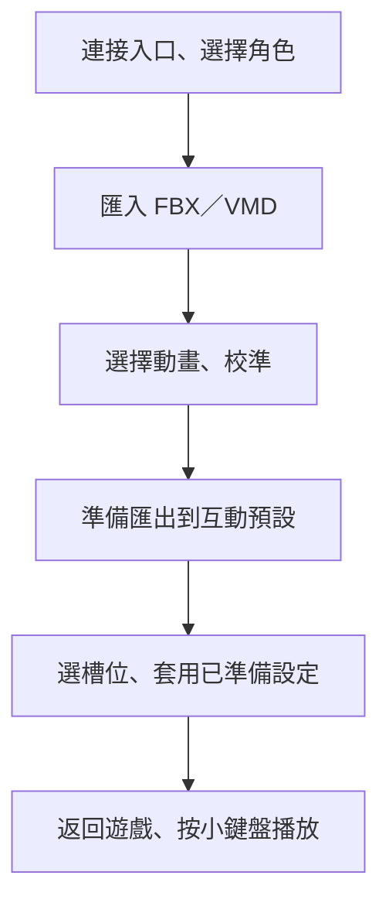

# EndfieldAnimationImporter 使用手冊

> **載入器：** 1.4.0（含）以前使用 [BEM 3.4.3](https://github.com/Dr-hydra/Better-Endfield)；1.5.0 起使用 [EML](https://github.com/Dr-hydra/Endfield-Mod-Loader)。

繁體中文 | [English](README.en.md)

適用版本：2.2.0｜Windows x64

## 使用前準備

- 安裝 EML；匯入 FBX／VMD 另需安裝 [Blender](https://www.blender.org/download/) 4.2 以上。
- 主控使用男性或女性管理員，互動角色需在隊伍內。
- 停用其他第一人稱／相機模組，再啟動遊戲。

1. 在 EML 匯入 EAI ZIP 並啟用，使用 EML「啟動遊戲」。更新模組後需重啟遊戲。
2. 進入可操作角色的場景，按 **Num0** 開啟面板。
3. 在「模組設定 → 互動角色」按「連接遊戲入口」。
4. 按「更新隊伍角色」，選擇並套用互動角色。

## 使用懶人包

## 匯入動畫

1. 停止目前動畫，確認主控與互動角色。
2. 開啟「動畫匯入」，檢查 Blender「當前路徑」。若未找到，按「選擇 Blender 資料夾」，選擇含 `blender.exe` 的資料夾。
3. 按「導入主控 FBX / VMD」或「導入配角 FBX / VMD」，選擇檔案並等待完成。
4. 到「校準模式」的主控／配角選單選擇動畫。匯入完成不會自動播放。

VMD 直接選檔即可，不需 MMD 參考模型；只匯入動作。**不保證所有 FBX 骨架通用，僅支援單一角色動畫。** 雙人動作請將兩人的動畫分別匯入主控與配角。

主控動畫綁定匯入時的男管／女管。配角更換角色後若動作異常，選好新角色再重新匯入。

未匯入主控動畫時，可用「主控預設姿勢」選擇站立、摟腰或摸頭；不需要則選「無」。這些姿勢為測試功能，接觸位置可能需要調整。

## 校準動畫

主控與配角各有一個校準選單。選擇動畫後會展開時間軸，從暫停狀態開始。

| 操作 | 用途 |
| --- | --- |
| 播放／停止動畫 | 預覽／還原角色，保留調整參數 |
| 循環校準動畫 | 重複播放 |
| 時間滑桿、前一格／後一格 | 定位並暫停；每格 1/30 秒 |
| 繼續／暫停播放時間軸 | 從目前時間播放或暫停 |
| 標記起點／終點、區間循環 | 選擇並反覆播放片段 |
| 同步主控/配角動畫 | 同步播放、停止、暫停、時間與起終點 |

播放／停止不會關閉面板，按 **Num0 或 Esc** 返回遊戲。

### 骨架與站位

1. 在「骨架設定」按「更新全部骨架」。
2. 展開主控或互動角色，調整對應骨架。人物根節點用於移動、旋轉整個角色；位移單位為公分，角度為度。
3. 拖曳滑桿，或點擊右側數值直接輸入數字。可輸入負數與小數。
4. 使用「還原骨架預設」清除調整。

建議先暫停在同一幀再調整，方便比較。

### 支撐模式

- **不固定**：一般動作、跳躍或抬腳。
- **左腳／右腳固定**：以單腳為支點。
- **左膝／右膝固定**：以單膝為支點。

支撐不會自動找地面。腳或膝蓋高度不合時，調整人物根節點的 Y 位移；需要重設支點時，停止再播放。

## 設定快捷鍵

1. 完成校準後，按「準備匯出到[互動預設]」。
2. 展開「互動預設」，選擇小鍵盤 1～9 的槽位。
3. 按「套用已準備設定」，再按「保存設定」。
4. 開啟 **Num Lock**，返回遊戲後按對應小鍵盤按鍵播放。

**按原鍵停止；按另一個已設定的鍵切換動畫。** 修改校準內容後，需重新準備並套用槽位。

要將其他角色校準的預設用在目前互動角色，勾選「啟用角色動畫互用」。身形不同會造成位置偏移；未勾選時，快捷鍵使用預設保存的角色；勾選時使用目前選定的互動角色。

## 保存片段與分享

先用時間軸標記起點、終點，片段至少需 0.2 秒。

| 按鈕 | 用途 |
| --- | --- |
| 保存動畫 | 將片段加入本機動畫列表 |
| 另存動畫片段 | 將片段存成動畫 JSON，不加入列表 |
| 另存參數設定 | 先按「準備匯出」，再保存校準參數 JSON |
| 讀取參數設定JSON | 將參數讀入目前快捷鍵槽位 |

動畫 JSON 在「動畫匯入 → 導入配角 JSON」讀取；參數 JSON 在「互動預設」讀取。**參數檔不含動畫。**

分享片段時：另存動畫片段 → 導入該 JSON → 選擇並校準 → 準備匯出 → 另存參數設定。將動畫與參數兩份 JSON 一起提供，避免參數引用不同動畫。

## 自由相機

先連接遊戲入口，在「自由相機」確認開關快捷鍵，關閉面板後按該鍵啟用；再按一次或按 **Esc** 退出。預設為 **F9**，可自行更改。自由相機啟用時可按 **1～9（主鍵盤或小鍵盤）** 播放互動預設；再按同一鍵停止，按另一鍵切換。

| 操作 | 用途 |
| --- | --- |
| WASD | 前後左右移動 |
| E／Q | 上升／下降 |
| 按住滑鼠右鍵拖動 | 轉動鏡頭 |
| 按住 Shift | 移動速度加倍 |
| 重設相機位置 | 回到主控附近 |

勾選「啟動相機時隱藏遊戲UI」可隱藏遊戲介面；退出後還原。

## 胸部晃動

在「胸部晃動」頁勾選「啟用互動角色胸部物理」。

- 勾選「自動套用到互動角色」：跟隨目前互動角色。
- 勾選「自動套用到主控角色」：跟隨目前主控，與自動套用互動角色互斥。
- 手動選擇角色：關閉兩個自動選項，改套用至隊伍中的指定非主控角色。
- 只使用內建預設，同時作用於一個角色。缺少預設或胸部骨架時，頁面會提示原因。
- 請勿同時讓其他胸部物理模組套用到同一角色。

## EFMI 外部模型調整

需另外安裝 EFMI 與外觀模組。

選擇 EFMI `Mods` 或單一模組資料夾 → 掃描模組 → 調整參數／網格 → 寫入橋接 → 回遊戲按 EFMI 重載鍵（通常為 F10，以面板顯示為準）。

還原預設或停用橋接後，也需重載。網格調整不會即時套用。

## 生成角色

連接遊戲入口並進入可操作場景，在最右側「生成角色」頁選擇幹員，按右側「生成」。模型會出現在主控前方約 2 公尺，並自動設為互動角色。下方「移除角色」可清除模型；選另一位幹員再生成會替換原模型。

生成後可匯入／校準配角動畫，或用快捷鍵播放互動預設。使用其他角色保存的預設時，勾選「啟用角色動畫互用」。同名角色也在隊伍時，優先使用生成模型。移除會先停止對應動畫；切換主控或模型失效時自動清理。

選單提供目前已知幹員；模型能否載入取決於客戶端資源，失敗時請查看提示與日誌。不同骨架／身形仍可能需要重新匯入或校準。生成僅作用於本機，不會解鎖角色。

## 常見問題與原因

| 問題 | 原因與處理方式 |
| --- | --- |
| 面板未出現 | 確認 EAI 已在 EML 啟用，並由 EML 啟動遊戲；更新後需重啟 |
| 無法連接入口 | 遊戲尚未就緒、其他相機模組佔用入口，或版本不相容；進入場景後重試，停用其他相機模組並重啟 |
| 找不到 Blender | 未找到安裝位置；手動選擇含 `blender.exe` 的資料夾 |
| 匯入要求停止動畫 | 角色正在播放或校準；先按「停止動畫」 |
| FBX 無法匯入 | 骨架可能不支援，或含多個角色；使用單一角色動畫 |
| VMD 無法匯入 | 檔案可能只有鏡頭，或骨名沒有對應；使用包含角色動作的 VMD |
| 動作扭曲或出現角色紅字 | 動畫與目前角色的骨架／身形不同；選定角色後重新匯入 |
| 主控角色不符 | 動畫綁定另一性別的管理員；切換對應管理員或重新匯入 |
| 腳穿地、手部接觸偏移 | 支撐、站位或身形不同；暫停後調整支撐與人物根節點 |
| 小鍵盤沒有反應 | Num Lock 未開啟、槽位空白，或角色不符；檢查槽位與角色提示 |
| 另存後列表找不到動畫 | 「另存」不會加入列表；導入該動畫 JSON，或使用「保存動畫」 |
| 讀取參數後顯示動畫缺失 | 參數檔不含動畫；先導入它引用的動畫 JSON |
| EFMI 調整沒有變化 | 尚未寫入橋接或重載，或該網格不支援調整 |

仍無法解決時，提供 EAI／EML 版本、使用角色、動畫檔名、操作步驟及畫面。日誌可在 EML 查看，或使用 DLL 旁的 `Interaction.Diagnostics.log`。

備份設定與動畫庫：複製 `%LOCALAPPDATA%\BetterEndfield\Interaction` 整個資料夾。

## 致謝

胸部骨架與角色預設資料參考 [Sp1cHless 的 Secondary-bodyphysics](https://github.com/Sp1cHless/Arknights-Endfield-Plugin-Secondary-bodyphysics)。
